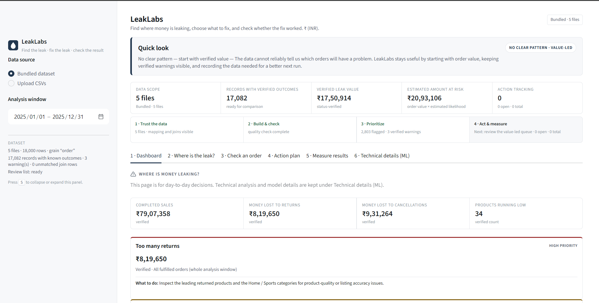
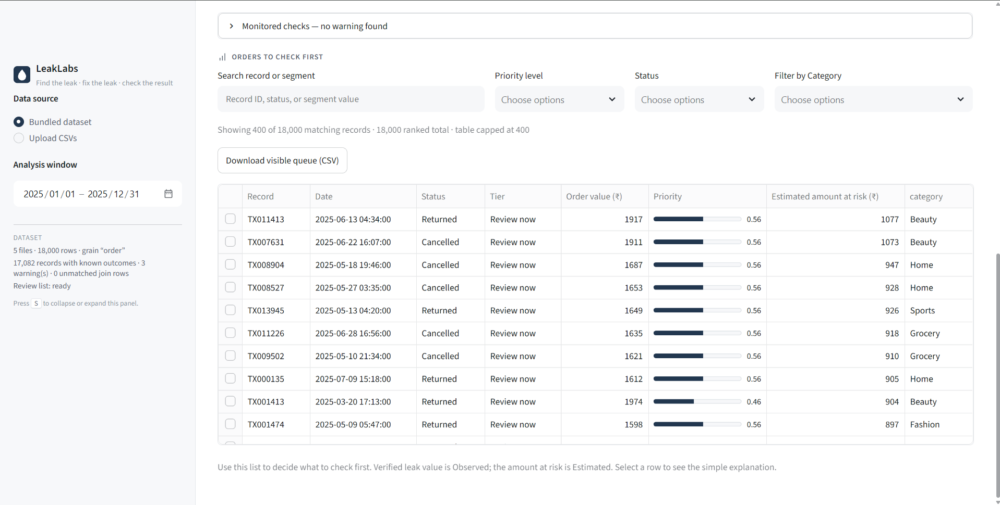

# 🔎 LeakLabs — The Money Leak

A **manager decision system for revenue leakage**. It profiles the CSVs, builds a
**leakage-safe feature table**, trains a model **from scratch in this project** on
the provided data, **audits whether that model actually predicts anything**, then
turns the result into a ranked **priority queue**, an **explainable** investigation,
a concrete **action**, and a **validation loop**.

Round 1 (the deterministic leak investigation) is retained inside the app.

Stack: **Python + Streamlit + pandas + Altair + scikit-learn**. No external API or
LLM is used as a predictor.

---

## Run it (one command)

```powershell
python -m pip install -r requirements.txt
python -m streamlit run app.py
```

or

```powershell
powershell -ExecutionPolicy Bypass -File .\run.ps1
```

The app opens on <http://localhost:8501>. Open **Technical details (ML)** and click
**Run analysis**. Training runs locally in ~10 seconds and writes
`artifacts/leaklens_model.joblib` so the evaluation renders instantly on later
visits. You can also **upload CSVs** and filter by a **date range**.

## Product screenshots

### Plain-language dashboard

The first screen answers the business question directly: where is money leaking,
how much is involved, and what should the manager do next?



### Order review list

Managers can search and filter the orders that need attention first, then open a
simple explanation for any selected order.



### Tests (no UI needed)

```powershell
python selftest.py     # profile, mapping, joins, rules, feature table, training, queue, audit
python test_app.py     # headless Streamlit AppTest: runs, trains, checks all six screens
python test_edge.py    # missing fields, renamed columns, dup keys, nulls, tiny samples
python test_actions.py # action IDs, local persistence, and safe status updates
```

---

## The six screens

| # | Screen | What the manager sees |
|---|---|---|
| 1 | **Dashboard** | A plain-language view of completed sales, money lost to returns/cancellations, low stock, and the top warning signs. |
| 2 | **Where is the leak?** | Searchable order list showing where to look first, verified warnings, clear Observed/Estimated labels, and CSV export. |
| 3 | **Check an order** | Simple explanation of why an order was marked and what a manager can do next. |
| 4 | **Action plan** | Choose an owner, due date, action, and recovery estimate; save the action and update its status. |
| 5 | **Measure results** | Before/after numbers and the next data needed to see whether the action helped. |
| 6 | **Technical details (ML)** | Data checks, feature list, model training, hold-out results, calibration, and the signal audit for technical reviewers. |

---

## The honest headline: this dataset has no signal

Before claiming the model works, we tested it. The provided data is **synthetic
random** with respect to the leakage outcome:

* Every feature looks the same across outcomes. Adverse rate is ~17.3% for Web/App/
  Store, every category, every region, every discount band, every quantity.
* Per-product adverse rate varies *less* than chance would produce (variance ratio
  0.93).
* `campaigns.spend/impressions/clicks/conversions` are mutually uncorrelated, and
  `inventory.stockout_flag` is uncorrelated with `supplier_delay_days`.
* `unit_price == list_price × (1 − discount_pct)` to the paisa.

So the app **reports the finding instead of faking a result**. The final model's
hold-out ROC-AUC is ≈0.50, its 95% bootstrap CI contains 0.5, and a **label
permutation test** (12 shuffled-label refits) gives `p ≈ 0.69` — the model's AUC
sits inside the null distribution. The verdict shown in the app is:

> **No detectable signal** — the hold-out AUC is inside the label-permutation null
> distribution. The model must not be trusted as a predictor on this data.

This is the point of the product: it is a system that **tells the manager when not
to trust a model**, then directs effort to verified value and the data that would
actually be needed.

---

## How the model is built (leakage-safe, from scratch)

| Stage | Choice | Why |
|---|---|---|
| **Target** | Cancelled **or** Returned = 1; Completed = 0 | Derived **only** from the verified status field. |
| **Excluded rows** | Pending / unknown status | Outcome is unobserved — a leakage guard, not a modelling choice. |
| **Features** | 24 pre-outcome fields (order, product, customer, time, inventory *as-of*) | Post-outcome fields (status, refunds, return reason, realised revenue) are **never** exposed. |
| **Inventory join** | `merge_asof` direction=backward | A later snapshot can never inform an earlier order. |
| **Split** | Temporal hold-out (fit Jan–Oct, test Oct–Dec) | Mimics real use; the test window is never seen in training. Stratified fallback if no dates. |
| **Baseline** | Logistic Regression | Interpretation floor. |
| **Final** | Random Forest (160 trees, seed 42) | Bagged, non-linear; `HistGradientBoosting` optional. |
| **Calibration** | Isotonic (`CalibratedClassifierCV`) | So probabilities are interpretable for *expected exposure*. |
| **Threshold** | Review-capacity quantile on a validation slice | Set by *how many orders a manager can action*, not an arbitrary 0.5. |
| **Audit** | Label-permutation test + bootstrap AUC CI | Decides whether the model is usable at all. |
| **Artifact** | `artifacts/leaklens_model.joblib` (pipeline + metadata) | Reproducible; refit only on data before the test window. |

Feature importances are **associations, not causes** — no causal claim is made.

### Observed vs Estimated (never mixed)

* **Observed leak value** — summed realised line value of records whose verified
  status is already Cancelled/Returned. Real money, no double counting.
* **Expected exposure** (*Estimated*) — `order value × predicted risk` for a set of
  records. A forward scenario.
* **Recoverable** (*Estimated scenario*) — `expected exposure × the recovery share
  you choose`. Never presented as forecast or realised revenue.
* **No profit/margin figure** is ever computed: `unit_cost > list_price` for 76 of
  250 synthetic products.

---

## Architecture (PRD §7)

| Module | Responsibility |
|---|---|
| `app.py` | Sidebar controls, session state, the six-screen flow |
| `leaklab/profile.py` | CSV inspection, type parsing, concept→column mapping, validators |
| `leaklab/data.py` | Safe joins (base grain + join health) and the **canonical feature table** with as-of inventory |
| `leaklab/train.py` | Leakage-safe split, preprocessing, baseline + final fit, metrics, calibration, threshold, permutation signal audit, artifact I/O |
| `leaklab/score.py` | Scoring, tiers, **expected exposure**, segment aggregation, exposure over time, driver evidence |
| `leaklab/rules.py` | Deterministic leak rules → `Alert` / `RuleStatus` (Round 1) |
| `leaklab/actions.py` | Leak→action library + local `action_log.csv` |
| `leaklab/metrics.py` | Metric functions with value, definition, availability |
| `leaklab/views.py` | The bespoke flat light design system and the six screens |
| `leaklab/model.py` | Backwards-compat shim re-exporting `leaklab.data` |

Schema-first: **no source column name is ever referenced literally.** Every field
resolves through the discovered mapping, so a renamed/missing column degrades to
`Unavailable` instead of crashing (see `test_edge.py`).

### Interface design

The Round-1 design system is unchanged: a limited slate/ink palette, system
sans-serif stack, hairline dividers instead of cards, inline **SVG icons**, muted
single-series charts, and INR with Indian digit grouping (e.g. `₹1,23,45,678`).
The app now opens with a **Manager control room** that makes the trust → audit →
prioritize → act path visible before the detailed screens.
Press **`S`** to collapse/expand the sidebar (client-side, no rerun). Charts follow
the PRD rule of **two high-signal charts in the active investigation** (screens 4);
screen 2's curves are evaluation artefacts, not investigation charts.

---

## Retained from Round 1 — deterministic rules that fired

| Rule | Threshold | Result | Status |
|---|---|---|---|
| **Returns** | > max(8%, 1.5× prior), ≥10 records | **9.3%** fulfilled, ₹8,19,650 Observed | ✅ Fired (#1, High) |
| **Cancellations** | > max(10%, 1.5× prior), ≥10 records | overall 9.4%; **22 products > 14.1%**, ₹1,62,244 Observed | ✅ Fired (#2, Medium) |
| **Low stock** | on-hand ≤ reorder threshold, or 0 with sales | **34 products**, ~₹11.5L **Estimated** proxy | ✅ Fired (#3, Medium) |
| Discount erosion | > 15% or 1.5× prior | 8.3% | ⬜ Monitored |
| Revenue anomaly | 7-day value ≥30% below prior | worst −27.1% | ⬜ Monitored |

The **denominator trap**: the return rate is 7.95% on *all lines* (below the 8%
rule) but 9.30% on the fulfilled denominator the PRD requires — using the correct
denominator is what makes the leak visible.

---

## Impact & responsibility

* The model's failure to generalise is **shown, not hidden** (audit verdict + calibration).
* Observed and Estimated values are always **separately labelled**.
* No fabricated attribution, no double-counted returns, no unlabelled cost/price.
* `campaigns` shares no key with `transactions`; it is reported independently and
  excluded from the model.
* When the model cannot predict, the app recommends **collecting the data that
  would make prediction possible** (return reasons, authorisation outcomes,
  fulfilment timestamps, promotion exposure) — and re-running the same pipeline.

## Explicitly out of scope

No LLM/API as a core model, no causal guarantees, no production deploy/auth/
integrations, no automated pricing or replenishment, no full profit/margin without
verified cost and realised-price fields.

---

## Acceptance criteria check (PRD §8)

- ✅ Runs locally from a documented command (`python -m streamlit run app.py`).
- ✅ No hard-coded column assumptions (schema-first mapping; edge-tested).
- ✅ Data-trust screen shows mappings, base grain, files, join health, warnings.
- ✅ Model trained **during the demo**, reproducible artifact + metrics.
- ✅ Baseline + held-out evaluation + threshold all visible.
- ✅ Leakage-protected: target from verified status only; post-outcome fields excluded.
- ✅ Priority queue → investigation with explanations and an action card.
- ✅ Inferred financials labelled **Estimated**; observed figures labelled **Observed**.
- ✅ 2-minute demo: raw data → ranked queue → action → validation metric, in-app.
- ✅ Honesty: the signal audit refuses to overclaim when the data has no signal.
